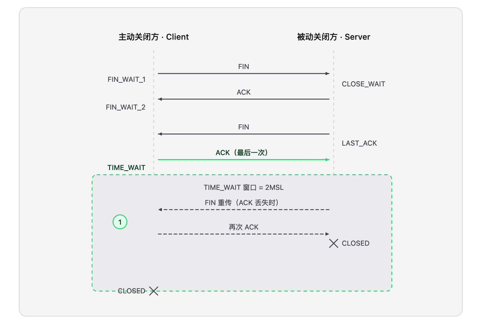
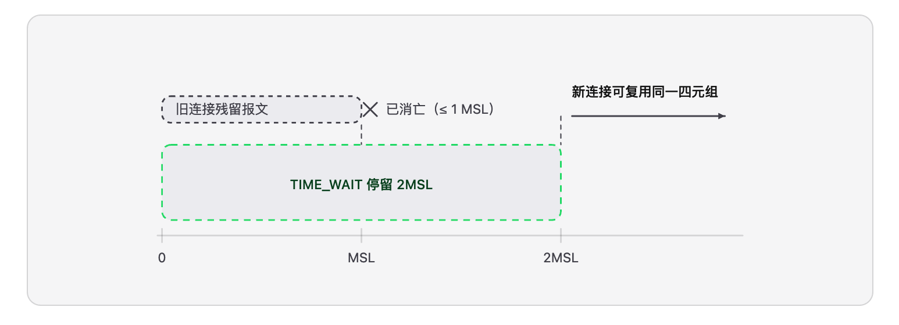

* content
{:toc}

上图展示的是四次挥手后半段的时序。重点在于：最后的 ACK 是“品牌色”的那条线，它一旦被主动方发出去，主动方就进入了 TIME_WAIT 窗口，而被动方实际上只等这一条 ACK 就可以彻底关闭了

#### 作用一：保证最后的 ACK 真的到达

最后一条 ACK 属于“不可靠传输”，网络中没有重传机制。如果 ACK 在途中丢失，被动方会停在 LAST_ACK，反复重传 FIN；而主动方如果发送完 ACK 就直接进入 CLOSED（处于关闭状态、不再监听），收到重传的 FIN 时只会回一个 RST，导致被动方异常关闭。所以主动方必须保持一个类似“僵尸”的状态：能收到重传的 FIN，也能再回一次 ACK。TIME_WAIT 就是为这种“答复能力”预留的存续窗口。

#### 作用二：让旧连接的残留报文自然消亡

这里更关键的是四元组复用，而不仅仅是等待对方关闭。

上图把 2MSL 拆成两段来看：旧的残留报文最多只能存活 1 个 MSL，而四元组在整段 2MSL 内都被 TIME_WAIT 占用，因此旧报文一定先于新连接消亡。

为什么非等 2MSL 而不是 1MSL 或 0

四元组是`(源IP, 源端口, 目的IP, 目的端口)` 。TCP 用四元组来唯一标识一条连接，同一个四元组上不能同时存在两条活跃连接。假设旧连接刚结束，我们立刻用同一个四元组发起新连接，而旧连接可能有重复的 FIN、重传的数据段或延迟投递的报文还在网络中流转。这些报文如果在新连接建立后到达，其序号完全可能落入新连接的接收窗口，被当作新连接的合法数据接收并上交给应用层，从而导致数据串流或状态机错乱。

所以协议需要一种机制，确保“旧报文全部过期”这件事在新连接可用之前完成。报文在网络中的最大生存时间被定义为 MSL（Maximum Segment Lifetime），一条旧报文最迟在它发出后 1 个 MSL 内被网络丢弃。而 TIME_WAIT 占住四元组 2MSL，正好覆盖：

区间	覆盖了什么
第一个 MSL	最后的 ACK 传到对端；若丢失，对端的 FIN 重传能回到我这里
第二个 MSL	我重发的 ACK 若也丢失，FIN 再重传一次仍能到达；同时所有旧报文彻底过期

两个作用其实是同一套时间预算的两个用途：第一个 MSL 用于保障“最后的 ACK 能送达”（作用一），整个 2MSL 用于保障“旧报文消亡”（作用二）。

几个容易混淆的点

- 被动方收到最后的 ACK 就 CLOSED 了，并不存在“两个人都卡在关闭中”。TIME_WAIT 是主动方单方面的责任状态，不是握手协商出来的。
- 主动方在 TIME_WAIT 期间仍然持有本地端口，所以对客户端来说这是“端口被占用”；这正是短连接客户端端口紧张、`Cannot assign requested address` 的根因之一。
- Linux 里 TIME_WAIT 实际是固定约 60 秒（`TCP_TIMEWAIT_LEN` ），而不是严格按 2×MSL 计算得到的 120 秒，MSL 只是逻辑上的 30 秒假设；`tcp_fin_timeout` 调的是 FIN_WAIT_2，跟 TIME_WAIT 无关。
- `tcp_tw_recycle` 已在 4.12 内核移除（在 NAT 下会造成连接异常）；`tcp_tw_reuse` 只对主动发起方向的连接生效，对作为服务端被动关闭的连接无效。服务端要减少 TIME_WAIT，正确做法是让客户端先关闭，或用长连接或连接池。
- 用 RST 强关虽然能跳过 TIME_WAIT，但会丢失未发完的数据，也会让对端抛出`Connection reset` ，属于权衡，并非优化。
一句话记忆：TIME_WAIT 不是在等对方关闭，而是在给自己留出“还能应答，并且等到网络上没有旧报文残留”的时间。#